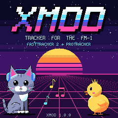
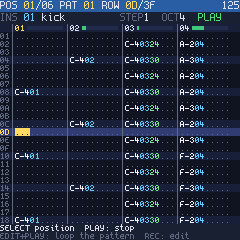
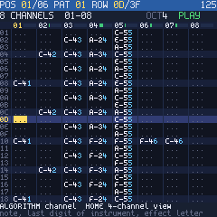
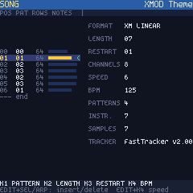
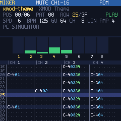
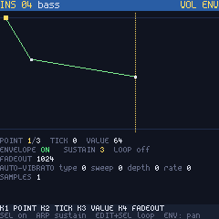
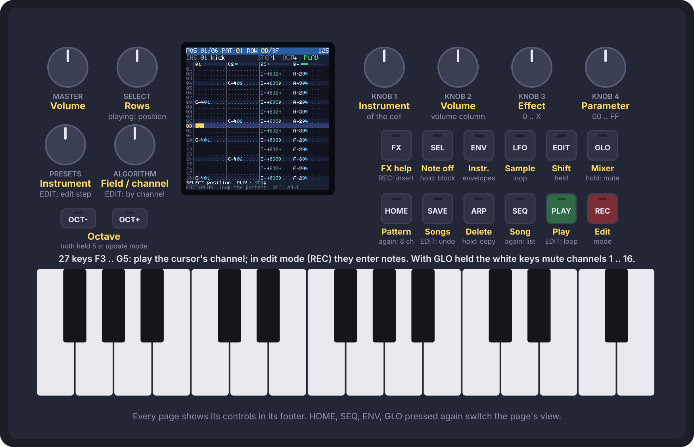

# XMOD

**A MOD / XM tracker for the M-VAVE FM-1.** Play, write and save FastTracker 2 and ProTracker songs
on the FM-1 itself: up to 32 channels, the FastTracker 2 replayer (ported from ft2-clone), a
ProTracker mode for MODs (Amiga panning, the A500 and LED filters), and a song manager in the
browser that moves songs between the FM-1 and the computer as .xm and .mod files.

  
  

**Try it in the browser:** [the XMOD simulator](https://kotmorderca.github.io/XMOD/sim/) runs the
firmware's own pages and player on a picture of the FM-1 (mouse or computer keyboard, with sound).

- **Pattern editor**: one knob per field (instrument, volume, effect, parameter), notes from the
  keys, note off, blocks with copy and paste, undo, 4 or 8 channels on the screen.
- **Song**: the order list, pattern lengths, new and copied patterns, speed, BPM, restart.
- **Instruments and samples**: volume and panning envelopes, loops, volume, panning, finetune.
- **Mixer**: meters, mute and solo on the white keys, global volume, tempo, amplification.
- **Effect help** on the screen for every XM effect.
- **Songs in flash**: save, load, new, rename, delete; up to 32 songs in 292 KB.
- **Over USB**: the song manager (serial), MIDI clock out and transport in, the FM-1 as an audio
  input (44.1 / 48 kHz).
- Two example songs built in, made for XMOD (`songs/`, CC0).

USB identity: **FM-1_666**. License: **GPL-3.0-only** (see LICENSE and THIRD_PARTY.md).

## Install

From [The Firmware Hub](https://thefirmwarehub.com/) or from this repository's releases
(`xmod.fwsc`), with any FM-1 installer: the hub's page, Felucca's web installer, or
`tools\install.cmd xmod.fwsc` from this repository. It installs over the official firmware (V15) and over other
custom firmwares; installing another firmware later leaves XMOD the same way (XMOD keeps the update
entry: the next update starts as usual). If the FM-1 ever does not start: hold OCT- and OCT+ at
power-on (update mode), then install again.

**Your data.** XMOD keeps its songs in the flash area other firmwares use for their projects
(0x97000..0xE0000, Felucca's data store). It cannot read what another firmware saved there, and its
first save overwrites it (other firmwares' data is not in a form XMOD understands, and the FM-1 has
no other room for songs). Back up before you switch (with that firmware's own backup), and before
leaving XMOD back up its songs with the song manager (Backup: a .zip of every song).

Then open the song manager (below).

## Controls



A button is a page; pressing it again switches the page's view. The song keeps playing underneath.
Every page shows its controls in the footer. The [simulator](https://kotmorderca.github.io/XMOD/sim/)
has the same controls, to learn them before installing.

| Control | |
| --- | --- |
| HOME | the pattern, 4 channels; again: 8 channels |
| SEQ | the order list and the song's settings; again: the pattern list |
| SAVE | the songs in flash and the built-in ones: SELECT a song, ALGORITHM an action (LOAD, SAVE, NEW, NAME, DEL), REC does it; PLAY loads and plays. SAVE replaces the song's own slot (a built-in song goes to a new one); NEW keeps the instruments; saving stops playback |
| FX | effect help, opened on the effect under the cursor; REC puts the chosen effect in the cell; FX again: back |
| GLO | the mixer: white keys mute (REC: solo), OCT+/OCT- channel bank; KNOB 1 global volume, 2 speed, 3 BPM, 4 amplification; a MOD: SEL ProTracker mode on / off, ARP stereo separation |
| ENV | the instrument (PRESETS): volume envelope, again: panning envelope. KNOB 1 point, 2 tick, 3 value, 4 fadeout; SEL envelope on, ARP sustain, EDIT+SEL loop; EDIT+KNOB 1/2/3 loop start / end / sustain point, EDIT+KNOB 4 number of points |
| LFO | the sample (ALGORITHM: which of the instrument's): waveform, KNOB 1 loop start, 2 loop length (EDIT: one frame at a time), 3 volume (EDIT: panning), 4 finetune (EDIT: relative note); SEL loop off / forward / ping-pong |
| GLO held + white keys | mute channels 1..16 on any page |
| PLAY | play from the position shown / stop; EDIT+PLAY: loop the pattern |
| REC | edit mode (red EDIT) |
| SELECT | stopped: rows (EDIT held: by 16); playing: jump by positions |
| ALGORITHM | the cursor field and channel (EDIT held: by channel) |
| KNOB 1..4 | edit mode: instrument, volume column, effect, parameter of the cell (EDIT held: by 16) |
| note keys | play on the cursor's channel; edit mode: enter the note with the PRESETS instrument, the cursor moves the edit step |
| PRESETS | the instrument notes go in with; EDIT+PRESETS: the edit step |
| OCT-/OCT+ | octave (the C in the middle of the keys is C of the octave shown) |
| SEL | note off (===); held while moving: select a block |
| ARP | clear the field (or the selected block); held: copy the block, or paste |
| EDIT+SAVE | undo |
| SEQ editing | KNOB 1 pattern at the position, 2 song length, 3 restart, 4 BPM (EDIT: speed); EDIT+SEL / EDIT+ARP insert / delete a position. Pattern list: KNOB 2 rows, EDIT+SEL new pattern, EDIT+ARP copy |

## Song manager

Open [kotmorderca.github.io/XMOD](https://kotmorderca.github.io/XMOD/) in Chrome or Edge on a
computer (WebSerial and WebMIDI), press Connect and pick the FM-1's serial port. It lists the songs in
the FM-1's flash; adds .xm, .mod and .fmtk files (drop them on the page); downloads a song as .xm, .mod
or .fmtk; renames, deletes and loads songs on the FM-1; backs everything up to a .zip and restores
it; installs a firmware package. A song that does not fit can have its 16-bit samples stored as
8-bit.

From the command line (Python 3 with pyserial):
`python tools/songs.py ls | get I FILE | put FILE [NAME] | del I | ren I NAME | load I | backup DIR | restore DIR`.

## MIDI and USB audio

Over the USB cable the FM-1 is a MIDI device, a serial port (the song manager) and an audio input.

- MIDI out: Start when playback starts, a clock per replayer tick (24 per quarter note at the song's
  BPM), Stop.
- MIDI in: Start (the song from the top), Continue, Stop; notes play the PRESETS instrument on the
  cursor's channel.
- Audio: the music at full level (MASTER sets only the speaker and the headphones), 44.1 or 48 kHz.

On Windows the FM-1's serial port may get a COM number another device already uses; give it another
one in Device Manager (Ports, the FM-1's USB serial device, Port Settings, Advanced).

## Limits

| What | Limit |
| --- | --- |
| channels | 32 (XM's maximum) |
| patterns | 256, up to 256 rows each; packed in 176 KB of RAM |
| instruments, samples | 128 instruments, 2048 samples; the sample data in flash |
| songs in flash | 32 songs, 292 KB for all of them |
| undo | 2048 changes |
| clipboard | 256 rows x 32 channels |

# Building

Linux or WSL, x86-64. Once: JieLi's toolchain (`JIELI_TOOLCHAIN`, default `~/.jieli/toolchain`;
Felucca's `tools/get_toolchain.sh` installs it) and the JieLi AC79 SDK
(`git clone --depth 1 --branch AC79NN_SDK_V1.2.1_2023-12-13 https://gitee.com/Jieli-Tech/fw-AC79_AIoT_SDK.git ~/fw-AC79_AIoT_SDK`,
or set `AC79_SDK`).

```
./build.sh [--release 1.0.0]     # -> build/xmod.fwsc (fetches Felucca into third_party/Felucca)
make -C host                     # the PC tools
make -C host test                # song memory and flash song slot tests
python3 tools/build_web.py       # build/web/xmod-songs.html (song manager), xmod-sim.html (simulator):
                                 # after ./build.sh or tools/get_felucca.sh; wasi-sdk 24 (WASI_SDK=path)
```

Releases: a `v*` tag builds, signs and publishes `xmod.fwsc` on GitHub (The Firmware Hub's
fm1-build workflow); pushes to `main` publish the song manager on GitHub Pages.

Install from Windows with the FM-1 on USB: `tools\install.cmd [PACKAGE.fwsc]` (Felucca's installer;
`--info` shows what the FM-1 runs). Update mode: OCT- and OCT+ held for 5 s while XMOD runs, or held
at power-on if the FM-1 does not start; then install again.

PC tools (`build/host/`): `convert` turns .xm / .mod / .fmtk into each other; `render` plays a song
into a WAV file; `uisim` runs the FM-1's pages with scripted input and writes PNG screenshots (the
steps are listed at the top of `host/uisim.c`).

| Path | What |
| --- | --- |
| `engine/` | the player (FastTracker 2 replay logic ported from ft2-clone, integer only, and the mixer) and the song in RAM; the same C on the PC and the FM-1 |
| `firmware/` | the FM-1 application on Felucca's hardware layer: the pages, editing, the flash song slots, audio, the USB console |
| `host/` | the converters (`modconv.c`: .xm / .mod -> FMTK, `modwrite.c`: FMTK -> .xm / .mod), `render`, `uisim`, tests, the WebAssembly build of the converters |
| `web/` | the song manager |
| `tools/` | the firmware and page builds, generators (font, splash screen, example songs, tables), `install.cmd`, `songs.py`, `console.py` |
| `songs/` | the example songs, built into the firmware |
| `third_party/fonts/` | the Spleen fonts |
